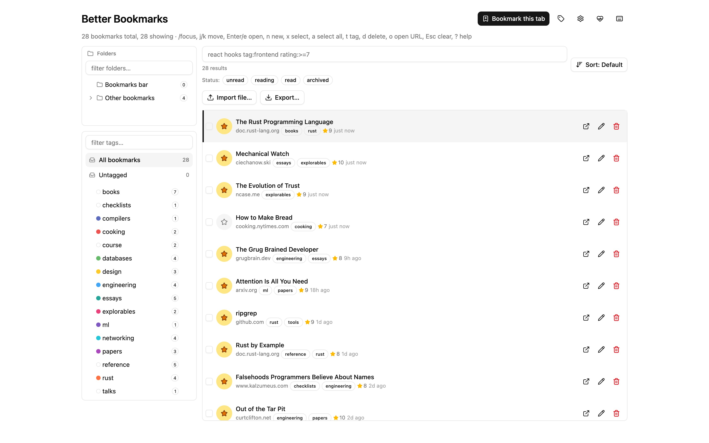

# Better Bookmarks

[](https://github.com/trebeljahr/better-bookmarks/actions/workflows/ci.yml?query=branch%3Amain)
[](LICENSE)

Better Bookmarks is a Chrome extension for people with too many bookmarks. You tag a bookmark instead of filing it in one folder, and the same page no longer gets saved twice under two different URLs.

Save an article once from a newsletter link and once from a social post, and you get one bookmark. The extension removes tracking parameters such as `utm_*`, `fbclid` and `gclid` before it compares URLs. Per-site rules catch more cases, such as a YouTube link with a start time. Each bookmark can carry many tags, a rating, a note, a reading time and links to related bookmarks.

Your bookmarks stay in Chrome's own bookmark tree, so the address bar and Chrome sync keep working. The tags, ratings and notes live in your browser, with no account and no server. The website is <https://bookmarks.trebeljahr.com>. The extension is not in the Chrome Web Store yet, so [install it from the release zip or from source](#install).



## What it does

- **Tags instead of one folder.** A bookmark can carry every tag that applies. Its Chrome folder becomes one of its tags. Mirroring a tag back to a Chrome folder is opt-in.
- **One bookmark per page.** URLs go through a canonicaliser with global and per-domain rules ([docs/URL_NORMALIZATION.md](docs/URL_NORMALIZATION.md)). A second save of the same page merges into the first.
- **Two-way sync with Chrome.** Chrome stays the source of truth for URL, title and folder. Changes on either side reach the other within a second or two ([docs/CHROME_SYNC.md](docs/CHROME_SYNC.md)).
- **Search.** A local IndexedDB index, designed for 20,000+ bookmarks. Type bare words, or filter with `tag:`, `domain:`, `is:unread` and `rating:>=7`. Optional semantic search runs a small model in the browser.
- Per-bookmark rating, reading time, content type, read state and note.
- Links between bookmarks, added by hand or suggested from shared tags and domains.
- Tag management: rename, merge, delete, colour and nesting.
- Import from JSON, standard bookmark HTML, CSV and HTML exports of read-later and book-tracking services, and plain URL lists. Export to JSON and bookmark HTML.
- A side panel, the toolbar button, the right-click menu and the `bb` keyword in the address bar. `Ctrl+Shift+X` opens the overview and `Ctrl+Shift+B` opens the side panel.
- A daily JSON backup to your Downloads folder that keeps the last 7 files.
- An optional dead-link checker that flags a URL only after it fails on three different days.

Better Bookmarks makes no analytics calls. The network features (dead-link checks, page metadata, the semantic search model) are off until you turn them on. [docs/PRIVACY.md](docs/PRIVACY.md) lists every request the extension can make.

## Install

The extension runs in Chrome. Firefox is not supported yet.

From the release zip:

1. Download `better-bookmarks-1.0-chrome.zip` from the [v1.0.0 release](https://github.com/trebeljahr/better-bookmarks/releases/tag/v1.0.0) and unzip it.
2. Open `chrome://extensions/` and turn on **Developer mode** in the top-right corner.
3. Click **Load unpacked** and pick the unzipped folder.

From source, run `pnpm install && pnpm build` (see [Development](#development)), then load `dist/chrome-mv3` the same way.

## Reporting bugs

Bug reports and feature requests go to [GitHub Issues](https://github.com/trebeljahr/better-bookmarks/issues/new/choose).

Include:

- **Extension version:** open `chrome://extensions`, find Better Bookmarks, copy the version string.
- **Chrome version:** open `chrome://version`, copy the first line.
- **Reproduction steps:** what you clicked, what you expected, what happened.

## Development

Requires Node 24 and pnpm 10 (pinned in `package.json`, so Corepack picks it up).

```sh
pnpm install
pnpm dev      # watch build into dist/chrome-mv3
pnpm build    # production build into dist/chrome-mv3
pnpm test     # Vitest, single run
pnpm check    # Biome format + lint
pnpm zip      # release zip into dist/
```

[CONTRIBUTING.md](CONTRIBUTING.md) explains how to add a canonicalisation rule, which is the most common change, and what a pull request needs.

### Project structure

| Path | What it holds |
| --- | --- |
| `src/entrypoints/` | The extension's pages: background worker, overview, side panel, options, health, offscreen |
| `src/core/` | Canonicaliser, Chrome sync, storage, search, import and export, backups |
| `apps/web/` | The website at bookmarks.trebeljahr.com (Next.js static export on a Cloudflare Worker) |
| `apps/rag-cli/` | An experimental local search CLI; the extension does not use it |
| `docs/` | Design docs, listed below |
| `press-kit/` | Store assets, screenshots, the social preview card and the press kit ([index](press-kit/README.md)) |

### Design docs

- [docs/PHILOSOPHY.md](docs/PHILOSOPHY.md): why this exists, the guiding principles, and what it does not do.
- [docs/ARCHITECTURE.md](docs/ARCHITECTURE.md): components, layers, module layout and data flows.
- [docs/DATA_MODEL.md](docs/DATA_MODEL.md): the on-disk schema for bookmarks, edges, tags, the Chrome mapping table and settings.
- [docs/URL_NORMALIZATION.md](docs/URL_NORMALIZATION.md): the canonicalisation pipeline and per-domain rules.
- [docs/CHROME_SYNC.md](docs/CHROME_SYNC.md): two-way sync, loop prevention and drift recovery.
- [docs/PRIVACY.md](docs/PRIVACY.md) and [docs/PERMISSIONS.md](docs/PERMISSIONS.md): every network request and every permission, with the reason.
- [docs/ROADMAP.md](docs/ROADMAP.md) and [docs/DECISIONS.md](docs/DECISIONS.md): the phased plan and the open design decisions.

### Tech stack

WXT (Manifest V3), React 19, Tailwind CSS 4 with shadcn/ui and Radix, Dexie over IndexedDB, Transformers.js for the optional semantic search, Vitest and Biome.

## Support

Better Bookmarks is free. If it saves you time, you can support the work at <https://ricos.site/donate/better-bookmarks>.

## License

MIT, see [LICENSE](LICENSE). The optional semantic search downloads the MIT-licensed `Xenova/bge-small-en-v1.5` model from Hugging Face on first use; the model is not part of this repository.
